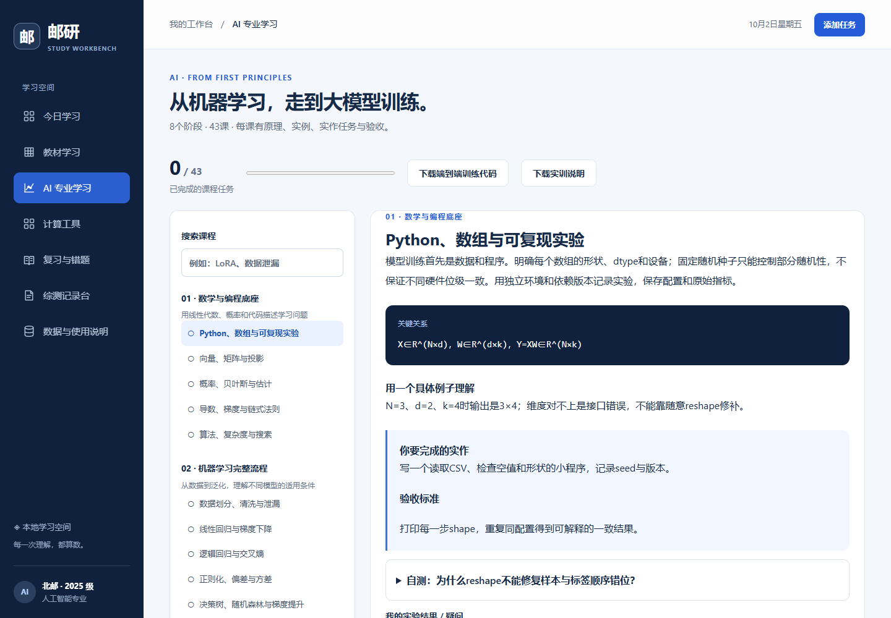

# Scholar Workbench

**English** · [简体中文](README.zh-CN.md) · [Security](SECURITY.md) · [Privacy](docs/PRIVACY.md)

A local-first learning workbench for PDF textbooks, AI coursework and training practice, and student activity evidence. Built with plain HTML, CSS and JavaScript, plus a Node.js standard-library loopback server. The current interface and authored curriculum are in Chinese; documentation is maintained in English and Chinese.

This independent educational project grew out of university AI study needs. It has no university endorsement and does not establish official degree requirements, grades or assessment credit.

## Capabilities and boundaries

| Area | Implemented | Boundary |
| --- | --- | --- |
| PDF learning | Local extraction; generated outlines, concepts, steps, comparisons, charts and quizzes; physical-page citations; Markdown export | Generation requires your own compatible API account (DeepSeek or a school gateway). Scans need external OCR. Verify formulas and answers against the PDF. |
| AI curriculum | 8 stages, 43 lessons: mathematics/Python, classical ML, deep learning, Transformers, pretraining, post-training, evaluation/RAG/deployment and projects | An authored study path, not a full degree program. Some engineering topics provide explanations and assignments rather than implemented systems. |
| Training practice | Tiny PyTorch Decoder with pretraining, SFT, LoRA, DPO, comparable evaluation, generation and pretraining resume | CPU teaching scale. Production LLM training, distributed execution and CUDA are not validated. |
| Activity evidence | Activity, organizer, award level, date, category, contribution and original document/photo paths; drag/drop, local selection, search, editing, desktop CSV + evidence ZIP | Evidence tracking without automatic official credit calculation. |
| Daily tools | Tasks, focus sessions, revision cards, Karnaugh maps, circuits, gradient descent, digit classification and metrics | Assumptions and algorithm boundaries are documented under `docs/`. |
| Full backup | Original PDFs, text, lessons, course notes/progress, evidence paths and legacy stored files/records | Plaintext JSON; referenced originals are excluded, while PDFs and legacy stored files retain their bytes. |



## Run locally

Browser mode requires **Node.js 18+** and a modern browser with ES modules, Web Workers and IndexedDB. Use a maintained Node.js LTS release; the compatibility minimum does not imply security support for old releases. Browser mode needs no npm dependencies. The optional desktop entry requires **Node.js 22.12+** and the pinned Electron runtime.

```sh
git clone https://github.com/yifanchen12/scholar-workbench.git
cd scholar-workbench
node server.js
```

Open **http://127.0.0.1:5179** and keep the process running. Windows users can also double-click `启动工作台.cmd`. The command-line entry is portable; full desktop acceptance for this version was performed on Windows/Edge.

For a different port, set `STUDY_PORT` to an integer from 1024 to 65535. PowerShell example:

```powershell
$env:STUDY_PORT = '5180'
node server.js
```

Use one stable browser origin. `file:`, `localhost`, `127.0.0.1` and different ports do not share storage. Export a full backup before changing addresses. Opening HTML directly is not equivalent to running the server. The server binds to `127.0.0.1`, for one person on their own machine, without public-network access or multi-user authentication.

### Desktop: drop evidence without typing paths

On Windows, double-click **`启动桌面工作台.cmd`**. The first launch installs the locked desktop dependency with npm and downloads its Electron binary; allow network access and keep that first installation window open. Subsequent launches use the installed runtime. The desktop window starts or reuses the local server automatically. Other systems can run `npm ci` followed by `npm run desktop`; native integration acceptance is currently on Windows.

If you already have browser records, click **“启用直接拖入”** in the browser's activity section or form to bring existing records and the current unsaved activity form into the desktop window. Install the desktop runtime first if this is a fresh clone. The source browser data remains intact. An existing desktop workspace is backed up before replacement after confirmation; records are not merged. Files previously dropped in a browser must be dropped once into the desktop window to obtain their real paths.

Desktop data is held in `.desktop-user-data/` beside the project, independently of browser profiles. It is ignored by Git and excluded from release archives. Keep using the same desktop directory, and export a full backup before moving it.

## Learn from a PDF

1. Import a PDF with a text layer. The original and extracted text remain in browser IndexedDB.
2. Enter the Base URL, API key and model identifier supplied by your provider or school. Calls occur only when you request generation and are billed to that account.
3. Generate an outline. This sends the first 120 and last 60 JavaScript characters per page, not a full review of the book.
4. Select a chapter or physical page range. A lesson request is limited to 40 pages and 100,000 JavaScript characters; split longer chapters.
5. Check explanations, formulas and answers against the PDF; inspect extracted text, save lessons or export Markdown.

Connection settings and the key are held in page memory, reset on refresh and excluded from persistence and backups. Selected text, book title and learning goal pass through the local server to the endpoint selected by the Base URL. The default is [DeepSeek](https://api-docs.deepseek.com/api/create-chat-completion/); compatible school gateways are supported. Outlines send excerpts; lessons send selected pages' full extracted text. Activity attachments, course notes and unrelated records are not sent. Provider handling is governed by its policies; check that you are permitted to transmit textbook content.

Decrypt password-protected PDFs and OCR scans first. Extraction can lose symbols, images and column order. Page references count physical PDF pages from the first page, not printed page labels. Schema and citation-range validation do not prove factual correctness. Without a key, local reading remains available and generation does not fabricate success.

Base URL examples (replace the illustrative school domain with the address supplied by your school):

| Input | Requested endpoint |
| --- | --- |
| `https://api.deepseek.com` | `https://api.deepseek.com/chat/completions` |
| `https://ai.example.org/campus/v1/` | `https://ai.example.org/campus/v1/chat/completions` |
| `https://ai.example.org/v1/chat/completions` | Used directly |

The gateway must support Bearer authentication, non-streaming Chat Completions, `response_format: {"type":"json_object"}`, and the requested output-token budget. Enter the school-provided model ID, including `/` or `:` if present. Connect the required campus network/VPN before generating. URLs must use HTTP(S), without embedded credentials, query parameters or fragments. Prefer HTTPS; HTTP sends keys and textbook text unencrypted and is intended only for explicitly trusted local/campus gateways. Automatic redirects are rejected: enter the final endpoint directly. The selected service, rather than necessarily DeepSeek, receives the data and credentials.

If the connection error reports `EACCES/EPERM`, local policy is preventing the Node.js process from using the network. Stop that server and run `node server.js` in an ordinary terminal, or grant outbound network access to that process. This failure occurs before an API HTTP response and does not determine whether a key or model is valid. An unauthenticated `401` establishes reachability only, not successful authenticated generation.

Generation has no workbench-imposed waiting deadline or response-inactivity timeout. Slow school gateways can continue until they respond; keep the page and server open. “Cancel generation” or closing the browser connection stops the local pending request. The app does not retry automatically. An external gateway can still return its own timeout or close the connection; that is reported separately, and cannot be prevented by removing the local deadline.

## Reproduce training

Basic Python exercises use the standard library. The tiny language model requires **Python 3.10+ and PyTorch 2.2+**. Use an independent virtual environment and follow [PyTorch's official installation instructions](https://pytorch.org/get-started/locally/) for your platform.

```sh
python practice/test_math_lab.py
python practice/run_lab.py
python tests/tiny_llm.test.py
python practice/tiny_llm.py all --steps 80 --output practice/llm-output
```

The default Decoder has 2 layers, dimension 64, 4 heads, a 64-token context and **107,804 base parameters**; LoRA trains **3,072 parameters**. The self-authored color question/answer corpus contains 16 training, 4 validation and 4 test examples. A character vocabulary is fitted on training-side material; unseen characters map to `<unk>` and are counted. No external base model or service key is required.

Runs produce checkpoints, logs, comparable evaluation and `training-report.json`, importable into the training viewer. SFT masks prompt labels, LoRA verifies frozen base weights, and DPO uses a frozen SFT reference. Pretraining can resume optimizer and CPU random state.

The bundled example is an actual CPU run. **Low loss is not general capability. Preference optimization does not guarantee lower language-model loss: the example includes DPO regression.** Generation has a fixed token count without EOS stopping and can repeat. CUDA, distributed training, PPO and production quantization are outside the validated implementation. See the [model card](docs/MODEL_CARD.md) and [detailed training guide in Chinese](docs/AI专业学习与训练实训.md).

## Records, limits and backups

Record activity, organizer, award, date and contribution, then **drop documents/photos or paste a clipboard image with Ctrl+V**. The desktop “粘贴照片” button also reads a copied image/screenshot. Select a photo folder once: subsequent photos are saved there immediately with unique names, displayed as thumbnails and opened in enlarged previews. The first clipboard save can prompt for that folder. Canceling an activity or removing its reference leaves these saved files intact. Changing the folder affects future photos. Without a configured folder, existing disk-backed drop behavior remains available. Photos never go to the textbook API.

Activity categories follow the development-quality section of the supplied **AI School 2025-cohort comprehensive evaluation rules for academic year 2025–2026**: ideological growth, academic innovation, physical/mental health, aesthetic education, labor literacy and organizational coordination, plus Other. Record the activity's organizational level and, for academic competitions, an optional S/A+/A/B+/B tier. Filters and CSV/ZIP/full backups preserve these fields; existing records retain legacy categories. The document's recognition period is 2025-08-21 through 2026-09-13 inclusive. Records may span other academic years. **The app organizes evidence and does not calculate or certify evaluation scores.**

**Local OCR in the Windows desktop app** automatically recognizes the first new previewable photo, or starts with “选图识别并填表”. It uses the installed Windows OCR language component, requires no API key, and fills only empty activity fields. Existing input stays intact; uncertain fields remain blank. Review the editable recognition text and form before saving. Browser mode can transfer the current draft, including photo bytes, into the desktop app. See [photo and OCR behavior](docs/LOCAL_OCR.md).

New full backups use the `youyan-workspace-v3` marker to prevent older apps from silently discarding path fields; the current app still imports old v2 backups. Restore with the current version.

In desktop mode, **“导出 CSV 与附件（ZIP）” exports the currently filtered list with its actual documents/photos, photo copies and legacy attachments**. Each activity has its own folder and the UTF-8 CSV uses relative paths inside the archive. Duplicate filenames stay separate; missing originals are reported. Export streams originals into the ZIP without changing them. Canceling or failure preserves existing output, and an original cannot be the destination. Browser export remains CSV-only.

**Full JSON backups include stored photo/legacy copies and path references; path-only originals still need separate protection or an evidence ZIP.** Moving/deleting a referenced original can break its preview. If no copy was stored, reselect the photo to retain a local copy; an unavailable original cannot be recovered from its path. Deleting a reference/activity never deletes originals. Copy metadata uses optional fields within the existing v3 backup format; the current app still imports v2. Unknown award information stays blank and credits follow official rules.

Limits: 50 MiB/1,000 pages per PDF, 30 books, 1,000 activities and 10 proof items per activity. A stored photo or legacy copy is at most 20 MiB; PDFs and stored copies share a 120 MiB limit. Preview decoding is limited to 40 million pixels. Imported backups are limited to 256 MiB. Browser quotas may be smaller.

Folder saves require desktop mode. Dropped files preserve original bytes; the native paste button encodes clipboard bitmaps as PNG. Normal photo references add no IndexedDB duplicate. Unsupported path previews can still use a saved browser copy. The private folder preference is excluded from workspace backups, while activity references include their saved paths. Folder photos are external originals for backup purposes: protect the folder separately or export the evidence ZIP. Browser mode accepts image paste/drop into its local store; its original-path/folder-writing operations require desktop mode. Ordinary text paste stays unchanged.

The textbook API panel links to [bupt-api campus API references](https://github.com/wzekin/bupt-api) and [BUPTapi-dsh local DSH setup](https://github.com/yifanchen12/BUPTapi-dsh). These are repository references, not automatic Base URL discovery or official LLM service guarantees.

Export before moving devices, clearing site data or substantial editing. Backups are plaintext JSON: **Base64 is not encryption**. Check their source and save the current backup before replacement. Private browsing, site-data deletion and storage failure can cause loss. Concurrent windows have no conflict merge. Legacy experiences/drafts migrate without inventing missing dates, organizers or awards.

## Verify and develop

Dependency-free checks:

```sh
node tests/core.test.js
node tests/cards.test.cjs
node tests/state-integrity.test.cjs
node tests/backup-size.test.cjs
node tests/digits.test.cjs
node tests/metrics.test.cjs
node tests/record-ocr.test.cjs
node tests/photo-storage.test.cjs
python practice/test_math_lab.py
python scripts/audit-public.py
```

With `node server.js` running in another terminal:

```sh
node tests/server.test.cjs
node tests/textbook-api.test.cjs
node tests/textbook-wait.test.cjs
node tests/desktop-transfer.test.cjs
```

API tests use mocked responses and a placeholder key, with no paid DeepSeek calls. Browser checks optionally require Playwright for development:

```sh
npm install --no-save --package-lock=false playwright
npx playwright install chromium
node tests/workspace-v2.test.cjs
node tests/photo-browser.test.cjs
```

Native integration uses real disk-backed fixtures, isolated Electron profiles and synthetic data: run `npm ci`, install Playwright as above, then `node tests/desktop.test.cjs` and `node tests/desktop-photos.test.cjs` plus `node tests/desktop-photo-folder.test.cjs` on Windows. These verify path extraction, previews, local OCR when its language component exists, fallback copies, record/form transfer, persistence and ZIP bytes without accessing the user's profile. The ZIP check uses Python; `STUDY_PYTHON_PATH` can select its executable.

`PLAYWRIGHT_PATH` selects a Playwright package, `BROWSER_PATH` a Chromium/Edge executable, and `STUDY_URL` a local address. End-to-end tests use isolated contexts and synthetic evidence; they exercise actual Chinese PDF extraction, course progress, path-only storage, legacy attachment-byte restoration, migration and 24 layouts. Historical v1 UI scripts are not current acceptance tests; see [validation scope](docs/VALIDATION.md).

Build portable archives with `python scripts/package-workbench.py`, then verify a fresh extraction with `python scripts/verify-release.py`. The main ZIP is generated and excluded from Git; the smaller Python practice download used by the interface is included.

## Project layout and maintenance

```text
server.js / deepseek-api.js       Loopback server and configurable API proxy
textbook*.js / vendor/pdfjs/      PDF extraction, validation and display
curriculum*.js / training*.js    Authored lessons, tools and recorded CPU run
records.js / vault.js             Evidence paths, legacy files, persistence and backup
practice/                        Python and PyTorch exercises
tests/ / scripts/                Verification, packaging and reproducibility
docs/                            Algorithms, privacy, model card and validation
```

Read [CONTRIBUTING.md](CONTRIBUTING.md) before contributing. Report vulnerabilities privately under [SECURITY.md](SECURITY.md); do not upload keys, textbooks, personal evidence or exploit details in public issues.

Original code and authored material use the [MIT license](LICENSE). PDF.js, font components and UCI-derived digit data retain their licenses and **are not relicensed under MIT**. See [THIRD_PARTY_NOTICES.md](THIRD_PARTY_NOTICES.md). User imports and third-party services are outside the project's license grant.
